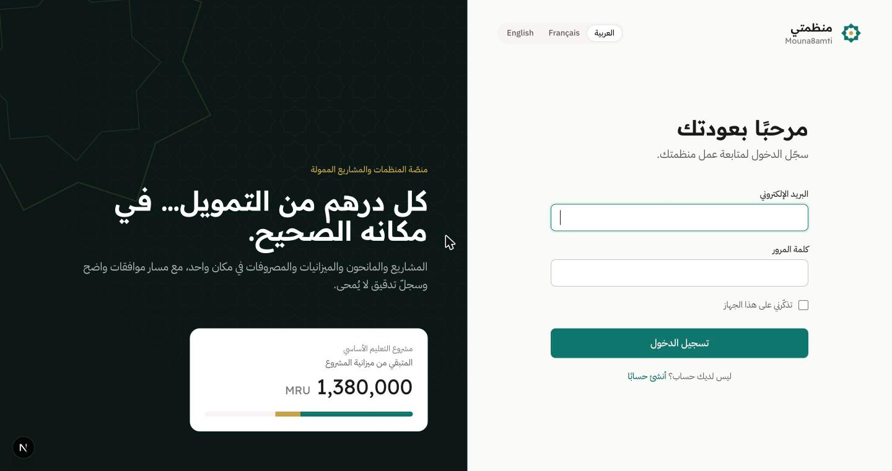
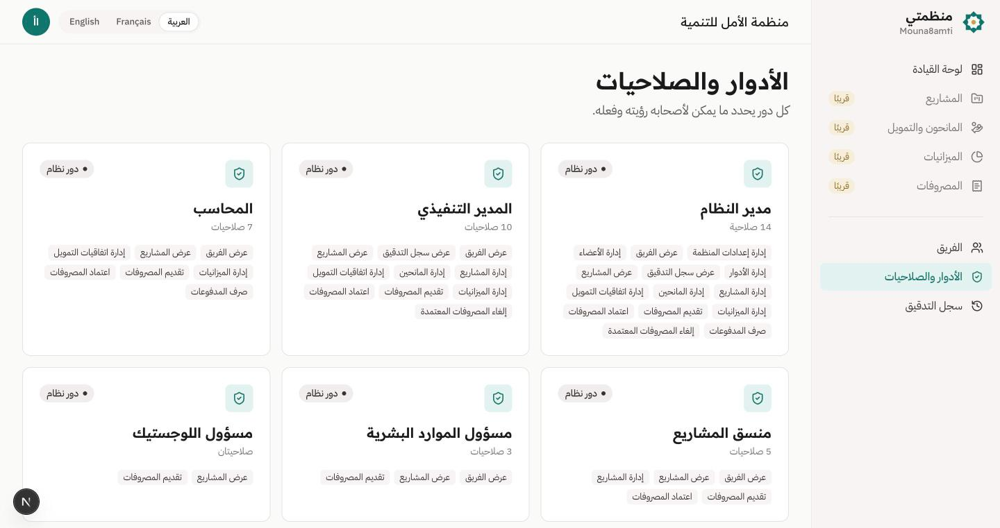
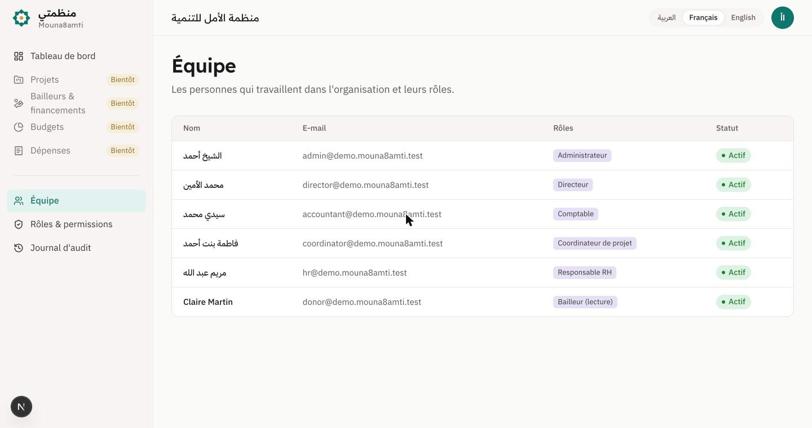

<div align="center">


# منظمتي · Mouna8amti

**A multi-tenant operating system for NGOs and donor-funded programmes.**
Arabic-first, with French and English. Every unit of funding is traceable from the donor agreement to the receipt.

[](https://github.com/AbdellahiAhmed/mouna8amti/actions/workflows/ci.yml)

</div>

<p align="center">
  
</p>

## Why it exists

NGOs in Mauritania and the wider region run grants worth millions on spreadsheets and WhatsApp groups. Nobody can say how much of a budget line is left. Approvals leave no trace. A donor report takes days to consolidate. Mouna8amti gives these organisations a single auditable system that donors can trust, built in the language the teams actually work in.

## What works today

| Area | Status |
|---|---|
| Sign-up, sign-in, session auth (Sanctum SPA cookies, CSRF, login throttling) | ✅ |
| Organisation onboarding wizard (country, currency, fiscal year, language) | ✅ |
| Multi-tenant isolation enforced by **PostgreSQL Row-Level Security** | ✅ |
| 7 system roles + permission catalogue, permission-aware UI | ✅ |
| Append-only audit trail (DB trigger blocks updates/deletes) | ✅ |
| Arabic (RTL) / French / English UI and API validation messages | ✅ |
| Project registry (status filter, search, manager, progress) and donor directory | ✅ |
| Grant agreements, budget lines, expenses with % allocation, approval engine | 🚧 Milestone 1, next |
| Double-entry accounting, procurement, HR, assets, donor portal, reports | 🗺 Milestones 2–4 |

The full product design lives in [`docs/specs`](docs/specs/2026-10-21-mouna8amti-design.md).

<p align="center">
  
  
</p>

## Architecture

```
mouna8amti/
├── apps/api        Laravel 12 · PHP 8.4 (FrankenPHP) · PostgreSQL 16 · Redis · Pest · Larastan L8
│   └── app/Domain/{Tenancy, Organizations, Access, Audit}
├── apps/web        Next.js 16 · React 19 · TypeScript strict · Tailwind v4 · Motion · TanStack Query · next-intl
│   └── src/{app/[locale], components/ui, features/<module>, i18n, lib}
├── docker/         PostgreSQL bootstrap (non-superuser application role)
├── compose.yaml    api · queue · web · pgsql · redis · mailpit
├── DESIGN.md       design system tokens and rules
└── docs/           spec, architecture decisions, screenshots
```

The browser only talks to the Next.js origin. `/api/*` and `/sanctum/*` are proxied to Laravel, so the session cookie stays first-party and CORS never comes into play.

### Decisions worth reading

- [ADR 0001: Tenant isolation with PostgreSQL Row-Level Security](docs/adr/0001-tenant-isolation-with-row-level-security.md)
- [ADR 0002: Permissions as a code-defined catalogue](docs/adr/0002-permissions-as-a-code-defined-catalogue.md)
- [ADR 0003: SPA session auth through a same-origin proxy](docs/adr/0003-spa-session-auth-through-same-origin-proxy.md)

## Run it locally

Requirements: Docker Desktop. No PHP or Node.js is needed on the host.

```bash
git clone https://github.com/AbdellahiAhmed/mouna8amti.git && cd mouna8amti
docker compose up -d --build                         # first boot installs dependencies
docker compose exec api php artisan migrate --seed   # schema + demo organisation
```

| Service | URL |
|---|---|
| Web app | http://localhost:3000 |
| API | http://localhost:8000 |
| Mailpit (outgoing mail) | http://localhost:8025 |
| PostgreSQL | `localhost:5433` (user `mouna8amti`) |

### Demo accounts

The seeder creates **منظمة الأمل للتنمية** with one account per role. All accounts share the password `Mouna8amti-demo-2026`. The seeder refuses to run outside `local`/`testing`.

| Email | Role |
|---|---|
| `admin@demo.mouna8amti.test` | Administrator |
| `director@demo.mouna8amti.test` | Director |
| `accountant@demo.mouna8amti.test` | Accountant |
| `coordinator@demo.mouna8amti.test` | Project coordinator |
| `hr@demo.mouna8amti.test` | HR officer |
| `donor@demo.mouna8amti.test` | Donor viewer (read-only, French UI) |

## Quality gates

```bash
docker compose exec api ./vendor/bin/pest           # feature tests on real PostgreSQL (RLS included)
docker compose exec api ./vendor/bin/phpstan analyse
docker compose exec api ./vendor/bin/pint --test
docker compose exec web npm run lint
docker compose exec web npm run typecheck
```

GitHub Actions runs all of them on every push. The API job creates the same non-superuser database role as Docker, because superusers bypass RLS and would make the isolation tests pass for the wrong reason.

The tests cover the risks that matter most: cross-tenant reads and writes (through the API **and** in raw SQL below the ORM), segregated permissions, the append-only audit trail, login throttling, and localised validation.

## Design

[`DESIGN.md`](DESIGN.md) is the source of truth for colours, type, spacing and motion. It starts from Notion's warm product chassis and Apple's discipline (one action colour, a single elevation shadow, press-to-scale feedback), adapted for Arabic. Body text is never smaller than 16 px, and Arabic text gets taller line-height and is never letter-spaced. The logo is a *Rub el Hizb*, an 8-point star. Its "8" is the one in Mouna8amti.

## Roadmap

1. **M1:** projects, donors & grants, budget lines, expenses with percentage allocation, configurable approval engine, dashboard.
2. **M2:** double-entry accounting, procurement (request → quotes → PO → receipt).
3. **M3:** HR, assets and stock.
4. **M4:** correspondence & archive, PDF/Excel donor reports, read-only donor portal.
5. **M5:** public landing site, production deployment.

---

Built by [Abdellahi Ahmed](https://github.com/AbdellahiAhmed).
