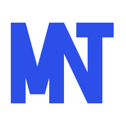

# MNT brand guide

**MNT** is the short form of **منظمتي** (*my organisation*). The mark is the name: a lettermark you read at a glance in any language, so it never needs translating or transliterating.

## The idea

M, N and T **share their stems**. The M's right stem is the N's left stem, and the N's diagonal lands on the T. Three letters become one connected block, because an organisation is people, projects and money that hold together.

Construction (`kit/mnt-symbol.svg`, 256 grid):

- three stems of equal width (30), cap height 164;
- every diagonal of the M is snapped to exactly **75°**, and the N diagonal runs stem to stem;
- the T crossbar is centred on its stem and has the stem's weight.

## Colour

| | Value | Use |
|---|---|---|
| **Lapis** | `#2B4FE8` · RGB 43 79 232 | The only brand colour. Logo, actions, focus |
| Lapis night | `#0A1033` | Dark brand panels |
| White | `#FFFFFF` | Logo on Lapis or night |

Lapis is the outremer of Islamic manuscripts and tilework. Blue carries trust in finance and B2B, and protection and truth across the Arab world. White on Lapis reaches **6.2:1** contrast (WCAG AA for all text sizes). There is one colour and no gradient.

## Versions

| File | When |
|---|---|
| `kit/mnt-symbol-mono-2b4fe8.svg` | Default, on light backgrounds |
| `kit/mnt-symbol-white.svg` | On Lapis, night or photography |
| `kit/mnt-symbol-black.svg` | One-colour print, fax, stamps |
| `kit/mnt-symbol-app-icon.svg` | App icon and favicon (white mark on a Lapis tile) |
| `kit/favicon.ico`, `icon-*.png`, `apple-touch-icon.png`, `site.webmanifest` | Web icon set |

In the product, the horizontal lockup is the mark, a hairline, then **منظمتي** set in Readex Pro (`apps/web/src/components/brand/logo.tsx`).

## Rules

- **Clear space:** keep at least one stem width (≈ 14 % of the mark's height) free on every side.
- **Minimum size:** 16 px tall on screen, 6 mm in print. Below 24 px, use the app-icon tile.
- **Don't** recolour outside the palette, add effects, outline, rotate, stretch, separate the letters, or set "MNT" in a typeface instead of using the drawing.

## Process

The three explored directions are in `concepts/concepts.png`: A Ligature (chosen), B Kufic tile, C Iʿjām dots. The process followed the [logo-design skill](https://github.com/kaankiziltug/logo-design-skill): brief, research, concepts, SVG construction, audit and a 16 px test.

> Trademark: "MNT" is also the ISO 4217 code of the Mongolian tögrög. A professional trademark search is recommended before any registration.
